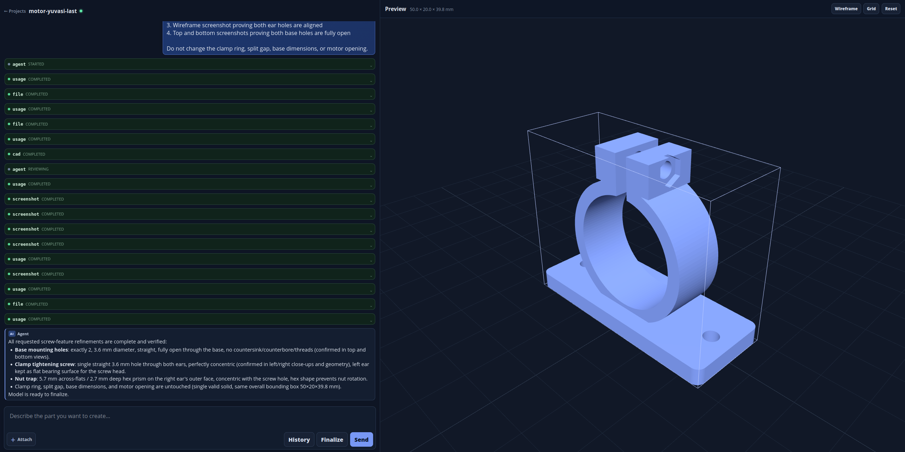
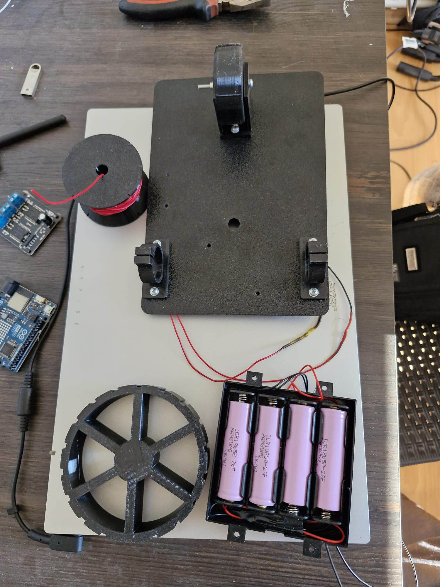
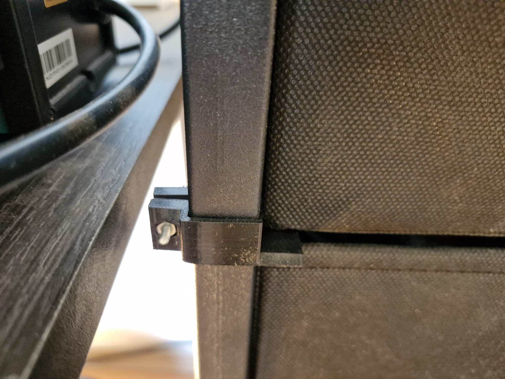

# 🏗️ Local AI CAD Agent

[](LICENSE)
[](https://www.python.org/)
[](https://github.com/neuronaline/local-ai-cad-agent/actions)

A local-first web application for **creating and refining parametric 3D CAD models through natural language**. Built with [OpenSCAD](https://openscad.org/), [Three.js](https://threejs.org/), and [Bubblewrap](https://github.com/containers/bubblewrap) for isolated execution. Run completely offline via **Ollama**, or connect to **OpenRouter**, **OpenAI**, **Gemini (Google AI Studio)**, or **Vertex AI**.

<p align="center">
  
</p>

<p align="center">
  
  
</p>

## ✨ Features

- **Chat-Driven Parametric CAD:** Authors and edits clean, parametric OpenSCAD (`model.scad`) from text prompts and reference images.
- **Deterministic Verification & Visual Review:** Validates manifold topology, volume, and bounds on every build, and renders an 8-view canonical contact sheet so the agent can visually inspect its own geometry.
- **Sandboxed Execution:** Runs OpenSCAD and math scripts inside an isolated Linux Bubblewrap (`bwrap`) container with detached networking, read-only system mounts, and `libseccomp` syscall filtering.
- **Interactive 3D Viewport & History:** Live Three.js preview, camera presets, wireframe/grid toggles, source diffs, and one-click revision rollbacks.
- **UI Model Switcher:** Configure multiple providers and models in `config.yaml` and switch models or reasoning effort directly from the Web UI.
- **Print Advisor & Multi-Format Export:** Hardware-aware print profile recommendations (`/print` & `user` printer config) with export to **3MF** (with embedded slicer settings), **STL**, **OpenSCAD (`.scad`)**, **OBJ**, **AMF**, **OFF**, or **CSG**.
- **Zero External CDN Dependencies:** All frontend assets are bundled locally in `static/vendor/`.

## 📋 Requirements

- **OS:** Linux (native) or Windows via **WSL2** (requires Linux user namespaces for `bwrap`).
- **Python:** 3.10+
- **System Packages:** `bubblewrap`, `libseccomp2`, `openscad`, `xvfb` *(automatically checked and installed via `apt-get` by `./install.sh`)*.

## 🚀 Quick Start

### 1. Install

```bash
git clone https://github.com/neuronaline/local-ai-cad-agent.git
cd local-ai-cad-agent
./install.sh
```

*(Creates `.venv`, installs dependencies, and initializes `config.yaml` and `.env` from their `.example` templates.)*

### 2. Configure LLM Provider

Set `llm.provider` (e.g. `openrouter` or `gemini:gemini-3.8-flash`) and define your models under `<provider>.models` in `config.yaml`:

| Provider | `llm.provider` | Auth & Model Setup |
|---|---|---|
| **Ollama (Local)** | `ollama` | Run `./setup_ollama.sh qwen3.8:27b` (no API key required) |
| **OpenRouter** | `openrouter` | Set `OPENROUTER_API_KEY` in `.env` and add model slugs under `openrouter.models` in `config.yaml` |
| **OpenAI** | `openai` | Set `OPENAI_API_KEY` in `.env` and add model slugs under `openai.models` in `config.yaml` |
| **Gemini** | `gemini` | Set `GEMINI_API_KEY` (or `GOOGLE_API_KEY`) in `.env`; models under `gemini.models` |
| **Vertex AI** | `vertex` | Run `gcloud auth application-default login`; models under `vertex.models` |

*(Optional: Set your 3D printer, nozzle, and filament under `user:` in `config.yaml` for tailored `/print` recommendations.)*

### 3. Run

```bash
./run.sh
```

Open **`http://127.0.0.1:8000`**.

> ⚠️ **Security Note:** The server binds to `127.0.0.1` with no built-in authentication. Do not expose it to untrusted networks without an authenticating reverse proxy.

## 🛠️ Agent Tools

The agent iterates using 7 structured tools:

- `read_file` / `write_file` / `edit_file` — Read and modify `model.scad`.
- `cad_build` — Compiles `model.scad` in the Bubblewrap sandbox, verifies mesh manifoldness/volume/risk score, and renders requested camera views.
- `get_view_images` — Loads rendered views or the 8-angle contact sheet into visual context.
- `python` — Runs restricted math and engineering calculations inside the sandbox.
- `question` — Prompts the user with a structured UI form when critical dimensions are ambiguous.

Projects are stored under `~/CAD-Agent-Projects/<project_name>/` (configurable via `workspace_root` in `config.yaml`).

## 🔧 Troubleshooting

**`bwrap: No permissions to create new namespace` (Ubuntu 24.04+)**  
Ubuntu 24.04+ restricts unprivileged user namespaces via AppArmor by default. Enable them with:
```bash
echo "kernel.apparmor_restrict_unprivileged_userns=0" | sudo tee /etc/sysctl.d/60-apparmor-namespace.conf
sudo sysctl --system
```

**Headless display errors (`Xvfb failed to start`)**  
Remove stale X11 lock files: `rm -f /tmp/.X99-lock /tmp/.X11-unix/X99`.

## 🧪 Development

```bash
.venv/bin/pip install -r requirements-dev.txt
.venv/bin/python -m pytest -q
.venv/bin/python -m ruff check .
```

## 📄 License

[MIT License](LICENSE) — Third-party vendor licenses are documented in [THIRD_PARTY_LICENSES.md](THIRD_PARTY_LICENSES.md).
